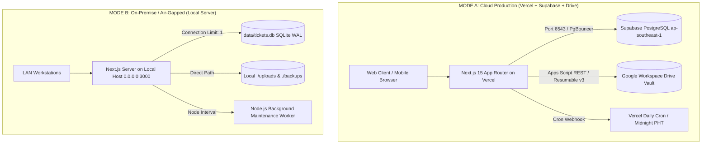
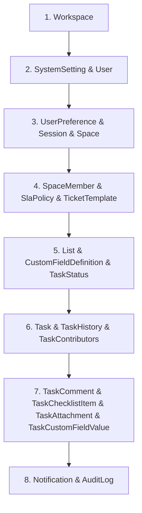

# Architecture & Cloud Portability Engine

## 1. Architectural Philosophy: The Dual-Mode Blueprint

`CLOUD-LNK-TICKET-SYSTEM` was engineered with a strict **Zero-Vendor-Lock-In** requirement. It can be deployed in production on modern serverless cloud infrastructure (**Vercel + Supabase + Google Drive**) or migrated seamlessly onto an air-gapped on-premise server (**Local Node.js + Local PostgreSQL/SQLite + Local File System**) without modifying any application code.

### High-Level Topology Architecture



---

## 2. Environment Configuration & Switch Matrix

The runtime switching mechanism is entirely declarative, governed by two primary environment variables:

| Environment Variable | Mode A (Cloud Production) | Mode B (On-Premise Server) | Architectural Impact |
| :--- | :--- | :--- | :--- |
| **`DATABASE_URL`** | `postgresql://postgres.<ref>:<pass>@<host>:6543/postgres?pgbouncer=true&connection_limit=25&pool_timeout=20` | `file:../data/tickets.db?connection_limit=1&socket_timeout=30` *(or local PostgreSQL)* | Controls whether `src/lib/db.ts` executes PostgreSQL JSON lateral joins or initializes SQLite WAL pragmas. |
| **`DIRECT_URL`** | `postgresql://postgres.<ref>:<pass>@<host>:5432/postgres` | *(Ignored in SQLite mode)* | Direct session pooler connection string used exclusively by Prisma CLI for migrations (`prisma db push` / `prisma migrate`). |
| **`STORAGE_PROVIDER`** | `"GOOGLE_DRIVE"` | `"LOCAL"` | When set to `GOOGLE_DRIVE`, attachments stream to Google Drive; when `LOCAL`, files write directly to `public/uploads/` on the server disk. |
| **`GOOGLE_DRIVE_BRIDGE_URL`** | `https://script.google.com/macros/s/<id>/exec` | *(Optional / Unused)* | URL of the Google Apps Script Web App bridge that handles Google Drive API operations without service account keys. |
| **`GOOGLE_DRIVE_BRIDGE_TOKEN`** | High-entropy secret token | *(Optional / Unused)* | HMAC/Bearer secret validated by `doPost(e)` and `doGet(e)` in `scripts/google-drive-bridge.gs`. |
| **`CRON_SECRET`** | High-entropy secret token | High-entropy secret token | Secures `/api/admin/backup/cron` against unauthorized invocation. |

---

## 3. Database Connection Architecture & Transaction Safety

The database connection layer is implemented in [`src/lib/prisma.ts`](file:///c:/Users/MIS/Documents/GitHub/CLOUD-LNK-TICKET-SYSTEM/src/lib/prisma.ts) and [`src/lib/db.ts`](file:///c:/Users/MIS/Documents/GitHub/CLOUD-LNK-TICKET-SYSTEM/src/lib/db.ts).

### 3.1. Supabase Supavisor Transaction Pooler (`:6543`) vs Direct Session (`:5432`)

- **Port 6543 (Transaction Mode):** Configured with `pgbouncer=true`, `connection_limit=25`, and `pool_timeout=20`. Used for all application queries. Each database query borrows a connection only for the duration of that single query and immediately returns it to the pool.
- **Port 5432 (Session Mode):** Configured as `DIRECT_URL`. Used only for Prisma schema migrations because DDL commands (table alters, index creates, enum migrations) require persistent session state.

> [!CAUTION]
> **CRITICAL INVARIANT: The PgBouncer Transaction Pooler Ban on Interactive `$transaction` Blocks**
> In PgBouncer transaction pooling mode, sequential client-side queries inside an interactive `prisma.$transaction(async (tx) => { ... })` must hold a connection open across cross-ocean network trips. If any network stall or delayed promise occurs, Supavisor terminates the session, resulting in a fatal **Prisma `P2028` Transaction API Error** (`Transaction already closed: could not perform query`).
> 
> **MANDATORY PATTERN:** Never use interactive transactions for creating tickets, spaces, or lists. Always use **Single Atomic Nested Writes** (e.g., `prisma.task.create({ data: { ..., checklistItems: { createMany: ... } } })`), which execute in a single round-trip at the database engine level.

### 3.2. Exponential Backoff Concurrency Guard (`withDbRetry`)

Implemented in [`src/lib/db.ts`](file:///c:/Users/MIS/Documents/GitHub/CLOUD-LNK-TICKET-SYSTEM/src/lib/db.ts):

```typescript
export async function withDbRetry<T>(
  operation: () => Promise<T>,
  options: { maxRetries?: number; initialDelayMs?: number } = {}
): Promise<T> {
  const maxRetries = options.maxRetries ?? 5;
  const initialDelayMs = options.initialDelayMs ?? 100;
  let attempt = 0;

  while (true) {
    try {
      return await operation();
    } catch (error: any) {
      attempt++;
      const isTransient =
        error?.code === 'P2034' || // Write conflict
        error?.code === 'P2028' || // Transaction timeout/closed
        error?.code === 'P2002' || // Unique constraint collision (e.g. taskKey race)
        error?.code === 'P1008' || // Operations timed out (Prisma query queue)
        error?.message?.includes('SQLITE_BUSY') ||
        error?.message?.includes('database is locked') ||
        error?.message?.includes('timeout');

      if (attempt >= maxRetries || !isTransient) {
        throw error;
      }
      const delay = initialDelayMs * Math.pow(2, attempt - 1);
      await new Promise((res) => setTimeout(res, delay));
    }
  }
}
```

This guarantees that under heavy concurrent ticket intake spikes (e.g. 50 staff creating tickets simultaneously), race conditions over unique ticket keys (e.g. `MIS-104`) or transient connection resets automatically resolve within milliseconds without throwing 500 errors to users.

### 3.3. SQLite WAL Concurrency Engine (On-Premise Fallback)

When `DATABASE_URL` starts with `file:`, `src/lib/db.ts` automatically initializes SQLite with high-concurrency pragmas:
- `PRAGMA journal_mode = WAL;` — Write-Ahead Logging allows simultaneous non-blocking concurrent readers while a write is occurring.
- `PRAGMA busy_timeout = 10000;` — Threads wait up to 10 seconds for locks before returning `SQLITE_BUSY`.
- `PRAGMA foreign_keys = ON;` — Enforces relational foreign key cascades.
- `PRAGMA synchronous = NORMAL;` — Maximizes write throughput while preventing disk corruption.

---

## 4. Portability & Migration Engines

The codebase provides three battle-tested utilities to move data bidirectionally between Cloud and On-Premise environments:

### 4.1. The SQLite-to-Supabase Cloud Migration Engine ([`scripts/migrate-sqlite-to-supabase.ts`](file:///c:/Users/MIS/Documents/GitHub/CLOUD-LNK-TICKET-SYSTEM/scripts/migrate-sqlite-to-supabase.ts))

Migrates historical SQLite records into Supabase PostgreSQL with **Strict Topological Dependency Ordering**:



#### Key Capabilities of the Migration Script:
1. **Direct Dual-Client Connection:** Connects simultaneously to local SQLite (`new PrismaClient({ datasourceUrl: 'file:...' })`) and Supabase PostgreSQL (`new PrismaClient({ datasourceUrl: process.env.DATABASE_URL })`).
2. **Topological Foreign Key Sorting:** Inserts parent tables (`Workspace`, `User`, `Space`) before dependent tables (`Task`, `TaskComment`) to prevent foreign key constraint violations.
3. **Smart Conflict Resolution (`UPSERT`):** All records use atomic `upsert` queries. Re-running the migration is completely idempotent and safe against network drops.
4. **Cross-System Role Normalization:** Automatically maps legacy roles (`STAFF` -> `ADMIN`, `REQUESTER` -> `EMPLOYEE`).
5. **Post-Migration Verification:** Executes parity count queries across all 22 tables to confirm 100% record match.

### 4.2. Bi-Directional Attachment Sync Engine ([`scripts/sync-attachments-with-drive.ts`](file:///c:/Users/MIS/Documents/GitHub/CLOUD-LNK-TICKET-SYSTEM/scripts/sync-attachments-with-drive.ts))

Used when transitioning storage providers:
- **Forward Push (`npm run sync:drive`):** Scans all `TaskAttachment` records stored locally on disk (`/uploads/...`), uploads them to the Google Drive shared folder via the Apps Script bridge, and updates the database `fileUrl` to the Google Drive stream URL.
- **Reverse Pull (`npm run sync:drive -- --pull`):** Scans the database for Google Drive file references, streams the binary chunks from Google Drive, and saves them to `./public/uploads/tasks/...` for air-gapped on-premise usage.

### 4.3. Full System Snapshot Export & Import API (`/api/admin/data/export` & `/import`)

Implemented in [`src/app/api/admin/data/export/route.ts`](file:///c:/Users/MIS/Documents/GitHub/CLOUD-LNK-TICKET-SYSTEM/src/app/api/admin/data/export/route.ts) and [`src/app/api/admin/data/import/route.ts`](file:///c:/Users/MIS/Documents/GitHub/CLOUD-LNK-TICKET-SYSTEM/src/app/api/admin/data/import/route.ts):
- **Export (`GET /api/admin/data/export`):** Reads all tables into an atomic JSON structure, compresses the stream with Gzip, and sends a single `.json.gz` download.
- **Import (`POST /api/admin/data/import`):** Accepts a `.json.gz` or `.json` file, validates the signature, and restores the entire database in topological order.
