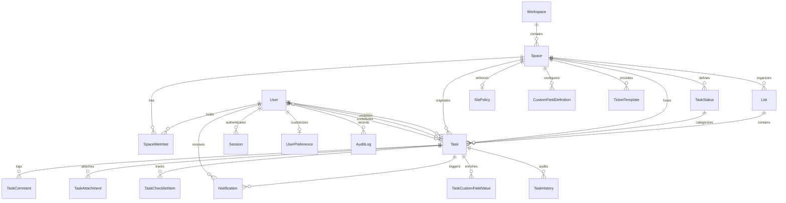

# Database Schema & Prisma ORM Patterns

## 1. Relational Model Map (22 Tables)

The database schema is defined in [`prisma/schema.prisma`](file:///c:/Users/MIS/Documents/GitHub/CLOUD-LNK-TICKET-SYSTEM/prisma/schema.prisma). It encapsulates an enterprise multi-department workspace with strict RBAC, queue isolation, SLA tracking, audit logging, and custom metadata fields.

### Entity Relationship Diagram



---

## 2. Table-by-Table Architectural Specifications

### 2.1. Core Identity & RBAC
- **`User`**:
  - `id` (CUID), `username` (unique), `email` (unique), `name`, `passwordHash` (Bcrypt), `globalRole` (`SUPERADMIN`, `ADMIN`, `EMPLOYEE`), `isActive`.
  - Serves as the primary security principal. Indexed on `[globalRole]` and `[username]`.
- **`Session`**:
  - `id`, `token` (unique 64-char hex string), `userId` (FK to `User`), `expiresAt`, `createdAt`.
  - Cascades on user deletion. Fast-indexed on `[token]` and `[userId]`.
- **`UserPreference`**:
  - `userId` (unique FK), `theme` (`dark`/`light`/`system`), `boardDensity` (3-6 columns), `compactCards` (boolean), `enableSound` (boolean), `notifyOnAssign` (boolean), `notifyOnStatus` (boolean), `hasCompletedTour` (boolean).

### 2.2. Organizational Structure
- **`Workspace`**:
  - `id`, `name`, `slug` (unique e.g. `lk-industries`). Root organizational container.
- **`Space`** (Departments):
  - `id`, `workspaceId`, `name`, `slug`, `key` (ticket prefix e.g. `MIS`, `HR`, `ACC`), `description`, `departmentHeadId` (FK to `User`).
  - Unique constraints on `[workspaceId, slug]` and `[workspaceId, key]`.
- **`SpaceMember`**:
  - Relational junction mapping `userId` and `spaceId` with role `SpaceRole` (`MEMBER`, `ADMIN`).
  - Unique constraint on `[spaceId, userId]`.
- **`List`** (Queue Lists):
  - `id`, `spaceId`, `name`, `description`, `color`, `order`, `isPrivate` (boolean).
  - When `isPrivate = true`, the queue is strictly hidden from non-space members unless explicitly shared or authored.

### 2.3. Workflow Engine & Tickets
- **`TaskStatus`**:
  - `id`, `spaceId`, `name`, `color`, `order`, `isCompleted` (boolean), `isClosed` (boolean).
  - Unique constraint on `[spaceId, name]`.
- **`Task`** (The Master Ticket Entity):
  - `id` (CUID), `taskKey` (unique human-readable ticket key e.g. `MIS-101`), `title`, `description`, `priority` (`LOW`, `NORMAL`, `HIGH`, `URGENT`).
  - `statusId`, `listId`, `spaceId`, `originSpaceId` (nullable FK to `Space`), `assigneeId` (nullable FK to `User`), `createdById` (FK to `User`).
  - **Planning Fields:** `startDate`, `dueDate`, `isMilestone` (boolean), `dependsOnIds` (JSON array of task prerequisite IDs), `progress` (0-100%).
  - **Composite Performance Indexes:**
    - `@@index([spaceId, createdAt])` — Rapid filtering within a department.
    - `@@index([spaceId, statusId, createdAt])` — Kanban board column aggregation.
    - `@@index([originSpaceId, createdAt])` — Sub-millisecond collaborated ticket reads.
    - `@@index([createdById, createdAt])` — Employee "My Submitted Tickets" view.
- **`TaskHistory`**:
  - `id`, `taskId`, `actorId`, `actionType` (`HANDOFF_TRANSFER`, `STATUS_CHANGE`, `CLOSED`, `REOPENED`), `fromSpaceId`, `toSpaceId`, `fromQueueName`, `toQueueName`, `notes`, `createdAt`.
  - Immutable audit trail recording every ticket movement and cross-department transfer.
- **`_TaskContributors`** (Implicit M:N join table):
  - Relational join between `Task` and `User` tracking every staff member who has collaborated on or transferred the ticket.

### 2.4. Metadata, Attachments & Checklists
- **`CustomFieldDefinition`**:
  - `id`, `spaceId`, `listId` (nullable: null applies to all queues in space), `name`, `fieldType` (`TEXT`, `NUMBER`, `CURRENCY`, `SELECT`, `DATE`), `options` (JSON string array), `isRequired`, `order`.
- **`TaskCustomFieldValue`**:
  - `id`, `taskId`, `fieldId`, `value` (string storage formatted by fieldType), `updatedAt`.
  - Unique constraint on `[taskId, fieldId]`.
- **`TaskChecklistItem`**:
  - `id`, `taskId`, `title`, `isCompleted` (boolean), `completedById`, `completedAt`, `order`.
- **`TaskAttachment`**:
  - `id`, `taskId`, `fileName`, `fileUrl` (Drive stream URL or local path), `fileType` (MIME), `fileSize` (bytes), `uploadedById`, `createdAt`.
- **`TaskComment`**:
  - `id`, `taskId`, `authorId`, `content`, `isInternal` (boolean: staff-only notes), `attachmentsJson` (inline images/files).
- **`TicketTemplate`**:
  - `id`, `spaceId`, `name`, `titlePrefix`, `defaultPriority`, `descriptionTemplate`, `defaultChecklist` (JSON array).
- **`SlaPolicy`**:
  - `id`, `spaceId` (unique), `urgentHours` (default 4), `highHours` (default 24), `normalHours` (default 72), `lowHours` (default 120).

### 2.5. Telemetry & Disaster Recovery
- **`AuditLog`**:
  - `id`, `event` (e.g., `UNAUTHORIZED_ACCESS_ATTEMPT`, `PERMISSION_GRANTED`, `BACKUP_CREATED`), `userId`, `resourceType`, `resourceId`, `ipAddress`, `details`, `createdAt`.
- **`Notification`**:
  - `id`, `userId`, `taskId`, `title`, `message`, `isRead`, `createdAt`.
  - Indexed on `[userId, isRead, createdAt]`.
- **`SystemSetting`**:
  - `id`, `key` (unique e.g. `backup_schedules_json`, `ai_settings`), `value`, `updatedAt`, `updatedBy`.

---

## 3. Transaction Safety Rules: The Zero P2028 Policy

### 3.1. Why Interactive Transactions Break on Connection Poolers
When executing an interactive transaction in Prisma:

```typescript
// ❌ FORBIDDEN PATTERN OVER PGBOUNCER (Causes P2028 timeouts)
await prisma.$transaction(async (tx) => {
  const task = await tx.task.create({ ... });
  for (const item of checklist) {
    await tx.taskChecklistItem.create({ ... }); // Round-trip 2, 3, 4...
  }
  await tx.taskHistory.create({ ... }); // Round-trip 5
});
```

1. In Supabase's transaction pooler (`:6543`), an open client connection cannot be pinned across multiple separate HTTP/TCP packet exchanges.
2. If network jitter or cross-region latency delays any statement by a few milliseconds, PgBouncer reallocates or closes the connection, causing:
   `PrismaClientKnownRequestError: P2028: Transaction API error: Transaction already closed: could not perform query.`

### 3.2. The Solution: Single Atomic Nested Writes
In [`src/app/api/tasks/route.ts`](file:///c:/Users/MIS/Documents/GitHub/CLOUD-LNK-TICKET-SYSTEM/src/app/api/tasks/route.ts), ticket creation is executed as a **single atomic PostgreSQL write statement**:

```typescript
// ✅ REQUIRED PATTERN: Single Atomic Nested Write
const task = await prisma.task.create({
  data: {
    taskKey,
    title,
    description,
    priority,
    statusId,
    listId,
    spaceId,
    createdById: user.id,
    checklistItems: checklistData.length > 0 ? {
      createMany: {
        data: checklistData.map((item, idx) => ({
          title: item.title,
          isCompleted: false,
          order: idx,
        })),
      },
    } : undefined,
    attachments: stagedAttachmentRecords.length > 0 ? {
      createMany: {
        data: stagedAttachmentRecords,
      },
    } : undefined,
    history: {
      create: {
        actionType: 'CREATED',
        actorId: user.id,
        toSpaceId: targetSpace.id,
        toQueueName: targetList.name,
      },
    },
  },
  include: {
    space: true,
    list: true,
    status: true,
    checklistItems: true,
    attachments: true,
  },
});
```

**Why This Works:**
- Executes in **1 single SQL command** sent to PostgreSQL.
- Requires zero connection pinning.
- Immune to `P2028` timeouts.
- Fully ACID-compliant: if any sub-item fails validation, PostgreSQL rolls back the entire insertion automatically.

---

## 4. Query Optimization & `relationJoins` Preview

In `prisma/schema.prisma`, line 3:
```prisma
generator client {
  provider        = "prisma-client-js"
  previewFeatures = ["relationJoins"]
}
```

In [`src/lib/task-store.ts`](file:///c:/Users/MIS/Documents/GitHub/CLOUD-LNK-TICKET-SYSTEM/src/lib/task-store.ts), `fetchMasterTaskList()` specifies:
```typescript
const rawTasks = await prisma.task.findMany({
  relationLoadStrategy: 'join', // Single lateral/JSON join roundtrip
  include: {
    space: { include: { statuses: true, customFields: true, slaPolicy: true } },
    originSpace: true,
    checklistItems: true,
    attachments: true,
    list: true,
    status: true,
    createdBy: { include: { spaceMemberships: { include: { space: true } } } },
    history: true,
    contributors: true,
  },
});
```

**Performance Benefit:**
- Without `relationJoins`, Prisma executes 10-12 separate sequential `SELECT ... WHERE id IN (...)` queries to hydrate related models. Over a 100ms connection to Supabase, this results in a 1,200ms cold start.
- With `relationLoadStrategy: 'join'`, Prisma constructs a single PostgreSQL query utilizing lateral JSON aggregations (`json_build_object()`, `json_agg()`), resolving the entire 22-relation dataset in **1 network round-trip (< 35ms)**.
