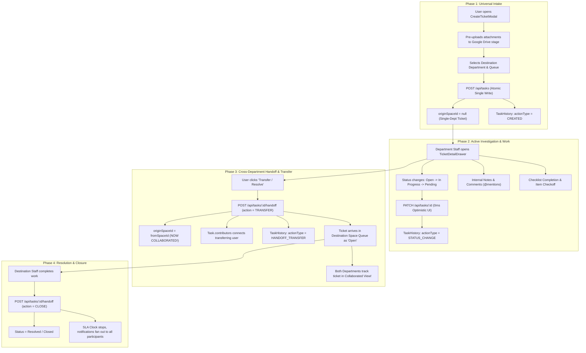

# Ticket Lifecycle & Cross-Department Collaboration Engine

## 1. End-to-End Ticket Lifecycle



---

## 2. Phase 1: Ticket Intake & Atomic Key Generation

### 2.1. Human-Readable Sequential `taskKey` Engine
Every ticket receives a unique key formatted as `${SPACE_KEY}-${COUNTER}` (e.g. `MIS-101`, `HR-104`, `ACC-112`).

In [`src/app/api/tasks/route.ts`](file:///c:/Users/MIS/Documents/GitHub/CLOUD-LNK-TICKET-SYSTEM/src/app/api/tasks/route.ts):
1. Queries the highest existing numeric suffix for the target department key:
   ```typescript
   const latestTask = await prisma.task.findFirst({
     where: { spaceId: targetSpace.id },
     orderBy: { createdAt: 'desc' },
     select: { taskKey: true },
   });
   ```
2. Extracts the numeric counter (or defaults to `101`).
3. Wraps key generation and creation in [`withDbRetry`](file:///c:/Users/MIS/Documents/GitHub/CLOUD-LNK-TICKET-SYSTEM/src/lib/db.ts). If two concurrent users submit at the exact same millisecond and hit a `P2002` unique constraint violation, `withDbRetry` catches the collision, increments the counter, and retries automatically.

### 2.2. Atomic Nested Creation
Executed in a single database round-trip (Zero `P2028` policy):
- Creates `Task`.
- Creates `TaskChecklistItem` entries via `checklistItems.createMany`.
- Links staged Google Drive attachments via `attachments.createMany`.
- Records `TaskHistory` event `CREATED`.
- Prepends task into server RAM cache (`prependTaskToMasterStore(task)`).
- Broadcasts real-time SSE event `TASK_CREATED` to space staff.

---

## 3. Phase 2: Status Resolution & 5 Canonical States

Different departments define custom status names (e.g., MIS uses *"Triaged"*, Accounting uses *"Audit Review"*, Safety uses *"Field Inspection"*). 

To ensure **global cross-department views (All Workspaces Kanban, List View, Gantt View) NEVER break or collapse into 0-height empty dropdowns**, the platform utilizes a deterministic **Canonical Status Resolver** in [`src/lib/status-utils.ts`](file:///c:/Users/MIS/Documents/GitHub/CLOUD-LNK-TICKET-SYSTEM/src/lib/status-utils.ts).

### 3.1. The 5 Canonical Workflow States

| Canonical ID | Canonical Name | Color | Category | Semantic Meaning |
| :--- | :--- | :--- | :--- | :--- |
| **`st-open`** | **Open** | `#3B82F6` | `OPEN` | Backlog, triage, or unstarted ticket |
| **`st-prog`** | **In Progress** | `#F59E0B` | `IN_PROGRESS` | Active investigation, execution, or development |
| **`st-pend`** | **Pending** | `#8B5CF6` | `PENDING_USER` | Waiting for user input, vendor response, approval, or blocked |
| **`st-reso`** | **Resolved** | `#10B981` | `RESOLVED` | Solution deployed, SLA stops, pending handoff/verification |
| **`st-clos`** | **Closed** | `#6B7280` | `CLOSED` | Completed, finalized, archived, or canceled |

### 3.2. Dynamic Resolver (`getResolvedWorkflowStatuses(task, spaces)`)
When rendering the status selector in [`TaskDetailDrawer.tsx`](file:///c:/Users/MIS/Documents/GitHub/CLOUD-LNK-TICKET-SYSTEM/src/components/drawers/TaskDetailDrawer.tsx) or [`ListView.tsx`](file:///c:/Users/MIS/Documents/GitHub/CLOUD-LNK-TICKET-SYSTEM/src/components/views/ListView.tsx):
1. Collects any custom statuses defined by `task.space.statuses`.
2. Matches custom statuses into the 5 canonical slots using regex heuristics (e.g. `name.includes("WIP")` -> maps to `st-prog`).
3. For any slot not explicitly defined by the department, provides the fallback canonical slot (`st-open`, `st-prog`, `st-pend`, `st-reso`, `st-clos`).
4. **Backend Smart Resolver (`PATCH /api/tasks/[id]`):** If a frontend view passes a synthetic canonical ID like `st-reso`, the API automatically resolves it to the space's actual `TaskStatus.id` before writing to PostgreSQL.

---

## 4. Phase 3: The Strict Cross-Department Collaboration Rule

> [!IMPORTANT]
> **ARCHITECTURAL INVARIANT: Initial Ticket Creation vs Collaboration Handoff**
> A frequent source of bugs in multi-department workflow systems is conflating *authoring origin* with *workflow collaboration*.
> 
> **THE RULE:**
> - When an employee in HR submits a ticket to MIS via `POST /api/tasks`, **`originSpaceId = null`**. The ticket belongs entirely to MIS. It is **NOT** a collaborated ticket.
> - A ticket **ONLY** becomes a `Collaborated` ticket when it is formally **Transferred / Handed Off** (`POST /api/tasks/[id]/handoff` with `action: 'TRANSFER'`).

### 4.1. Handoff Transfer Pipeline (`/api/tasks/[id]/handoff`)
When Department A (e.g. MIS) needs Department B (e.g. Accounting) to purchase hardware before MIS can proceed:
1. MIS staff clicks **Transfer / Resolve** in `TaskDetailDrawer.tsx`.
2. Selects Target Department (`Accounting`), Target Queue (`Purchase Orders`), and inputs handoff notes.
3. Backend atomically executes:
   - `spaceId = targetSpace.id` (moves active ticket to Accounting).
   - `originSpaceId = task.originSpaceId || task.spaceId` (permanently tags MIS as originating department).
   - `contributors.connect({ id: user.id })` (wires the transferring staff into the ticket's contributor list).
   - `statusId = targetSpace.defaultOpenStatusId` (resets to Open in Accounting).
   - `TaskHistory.create({ actionType: 'HANDOFF_TRANSFER', fromSpaceId, toSpaceId, notes })`.
4. **Collaboration Fan-Out:** `fanOutCollaborationNotification()` alerts all department members in both Origin and Destination spaces.

### 4.2. Filter Contract for `fastView=collaborated`
Implemented in [`src/lib/collaboration.ts`](file:///c:/Users/MIS/Documents/GitHub/CLOUD-LNK-TICKET-SYSTEM/src/lib/collaboration.ts):
```typescript
export async function buildCollaboratedTaskFilter(user, prismaClient) {
  const userSpaceIds = await getUserAssignedSpaceIds(user.id, prismaClient);
  return {
    OR: [
      // 1. Ticket originated in user's space, now sitting in another space
      { originSpaceId: { in: userSpaceIds } },
      // 2. Ticket transferred into user's space from another space
      { spaceId: { in: userSpaceIds }, originSpaceId: { not: null } },
      // 3. User is an explicit contributor on the ticket
      { contributors: { some: { id: user.id } } },
    ],
  };
}
```

---

## 5. Phase 4: Comments, `@Mentions`, and Audit Logs

### 5.1. Internal Notes Security (`isInternal = true`)
- Department staff can post comments with `isInternal: true` (highlighted in amber with a lock icon).
- **Security Guard (`src/lib/security/query-guard.ts`):** `sanitizeCommentsForUser()` strips internal notes from the API payload before sending to any user who lacks staff clearance in that ticket's space. Requesters and external users cannot read internal notes even by inspecting raw network responses.

### 5.2. Mention Autocomplete (`GET /api/users/mentions`)
- Typing `@` inside the comment box queries `/api/users/mentions?taskId=${taskId}&spaceId=${spaceId}`.
- Returns all members of the ticket's space, originating space, and explicit contributors, tagged with department badges.
- When posted, `@username` mentions are parsed and dispatch instant notifications to the mentioned users.
