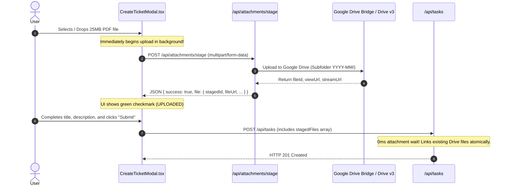
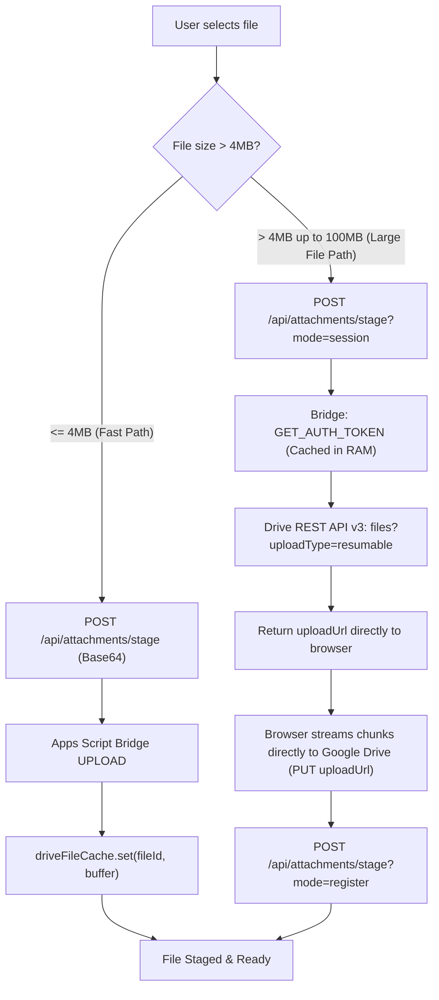

# Storage Pipeline & Google Drive Bridge

## 1. Enterprise Storage Architecture

To provide scalable storage without requiring costly AWS S3 buckets or exposing sensitive Google Cloud service account keys, `CLOUD-LNK-TICKET-SYSTEM` utilizes a **Google Workspace Apps Script Bridge** ([`scripts/google-drive-bridge.gs`](file:///c:/Users/MIS/Documents/GitHub/CLOUD-LNK-TICKET-SYSTEM/scripts/google-drive-bridge.gs)).

### Architectural Strengths:
1. **Zero GCP Infrastructure Cost:** Utilizes the company's existing Google Workspace enterprise drive storage.
2. **Zero-Credential Security:** No service account keys, private key files, or OAuth client secrets are embedded in the serverless bundle.
3. **Execution as Administrator:** The Apps Script Web App runs under the authority of the workspace owner (`Execute as: Me`, `Access: Anyone`), granting scoped read/write access to designated corporate folders (`ATTACHMENTS` and `BACKUPS`).
4. **Vercel 4.5MB Payload Limit Bypass:** Combines direct Base64 upload for small files with **Google Drive REST API v3 Resumable Sessions** for files up to **100MB+**.

---

## 2. Google Apps Script Bridge Actions Reference

The bridge communicates over HTTPS using a shared HMAC token (`GOOGLE_DRIVE_BRIDGE_TOKEN`). It handles both `GET` and `POST` requests in [`scripts/google-drive-bridge.gs`](file:///c:/Users/MIS/Documents/GitHub/CLOUD-LNK-TICKET-SYSTEM/scripts/google-drive-bridge.gs):

| Action Name | Method | Parameters | Function & Response |
| :--- | :--- | :--- | :--- |
| **`PING`** | `GET` / `POST` | `token` | Verifies bridge connectivity and returns vault storage statistics (`storageUsedBytes`, `storageLimitBytes`, folder names). |
| **`GET_AUTH_TOKEN`** | `GET` / `POST` | `token`, `target`, `subFolder` | Returns an ephemeral OAuth2 access token (`ScriptApp.getOAuthToken()`) cached for **45 minutes in server RAM** to authorize direct Google Drive v3 REST calls. |
| **`INIT_RESUMABLE_UPLOAD`** | `POST` | `token`, `fileName`, `mimeType`, `subFolder`, `fileSize`, `origin` | Calls Google Drive v3 REST API to generate a unique resumable `uploadUrl` session. |
| **`UPLOAD`** | `POST` | `token`, `target`, `fileName`, `mimeType`, `base64Data`, `subFolder` | Direct Base64 upload for files `<= 4MB`. Automatically creates subfolders partitioned by `YYYY-MM`. |
| **`DOWNLOAD`** | `GET` / `POST` | `token`, `fileId` | Streams binary file content back as Base64. |
| **`LIST_BACKUPS`** | `GET` / `POST` | `token` | Queries `.json.gz` database backup files in the `Backups` shared folder. |
| **`DELETE_FILE`** | `POST` | `token`, `fileId` | Permanently deletes a file from Google Drive (used for rollback of canceled attachments). |

---

## 3. The Eager Pre-Upload Staging Pipeline

A major usability issue in traditional ticket systems is waiting minutes for large files to upload *after* clicking "Submit Ticket". 

`CLOUD-LNK-TICKET-SYSTEM` implements **Eager Pre-Upload File Staging** in [`src/components/modals/CreateTicketModal.tsx`](file:///c:/Users/MIS/Documents/GitHub/CLOUD-LNK-TICKET-SYSTEM/src/components/modals/CreateTicketModal.tsx) and [`src/app/api/attachments/stage/route.ts`](file:///c:/Users/MIS/Documents/GitHub/CLOUD-LNK-TICKET-SYSTEM/src/app/api/attachments/stage/route.ts):



### 3.1. Automatic Rollback on Modal Cancel or File Removal
If a user stages a 50MB video but decides to remove it (or closes the browser tab):
1. `CreateTicketModal.tsx` fires `DELETE /api/attachments/stage?fileUrl=${encodeURIComponent(file.fileUrl)}`.
2. [`src/app/api/attachments/stage/route.ts`](file:///c:/Users/MIS/Documents/GitHub/CLOUD-LNK-TICKET-SYSTEM/src/app/api/attachments/stage/route.ts) extracts the `fileId` via `extractDriveFileId()`.
3. Calls `deleteFromGoogleDrive(fileId)` to purge the orphaned file from Google Drive, preventing storage leaks.

---

## 4. Large File Streaming up to 100MB (Vercel 4.5MB Bypass)

Vercel enforces a strict **4.5MB request body size ceiling** on serverless functions. Attempting to post a 10MB or 50MB file directly to a Next.js serverless route results in `413 Payload Too Large`.

The platform bypasses this limitation using a dual-track upload pipeline:



### 4.1. Direct Browser-to-Drive Resumable Upload Session (`client-file-uploader.ts`)
All 3 upload entrypoints (`CreateTicketModal.tsx`, `TaskDetailDrawer.tsx` direct attachment dropzone, and `TaskDetailDrawer.tsx` comment attachment composer) share [`src/lib/client-file-uploader.ts`](file:///c:/Users/MIS/Documents/GitHub/CLOUD-LNK-TICKET-SYSTEM/src/lib/client-file-uploader.ts) (`uploadFileWithProgress()`).

For any file `> 2MB` (or automatic `413` fallback):
1. **Step A (`INIT_LARGE_UPLOAD`):** Client sends a tiny `< 200B` JSON request to `POST /api/attachments/stage` with `{ action: 'INIT_LARGE_UPLOAD', fileName, mimeType, fileSize }`.
2. **Direct Node.js Session Initiation with Browser `Origin`:** `getGoogleDriveUploadSession()` in [`src/lib/google-drive-bridge.ts`](file:///c:/Users/MIS/Documents/GitHub/CLOUD-LNK-TICKET-SYSTEM/src/lib/google-drive-bridge.ts) retrieves `accessToken` + `folderId` via `GET_AUTH_TOKEN` and initiates `POST https://www.googleapis.com/upload/drive/v3/files?uploadType=resumable&supportsAllDrives=true` directly from Node.js with the browser's `Origin` header (`request.headers.get('origin')`). Passing `Origin` directly to Google Drive v3 guarantees `Access-Control-Allow-Origin` headers on the returned `uploadUrl` without needing Apps Script changes.
3. **Step B (Direct Browser `PUT uploadUrl`):** The browser streams raw binary bytes directly to Google Drive via `XMLHttpRequest` (`PUT uploadUrl`), reporting live `xhr.upload.onprogress` (`5% -> 95%`) and completely bypassing Vercel's 4.5MB serverless body limit.
4. **Step C (`FINALIZE_LARGE_UPLOAD` & Server Fallback Lookup):** Client calls `POST /api/attachments/stage` with `{ action: 'FINALIZE_LARGE_UPLOAD', fileId, fileName, savedFileName, folderId, mimeType, fileSize }`. If opaque CORS ever prevents the browser from reading `xhr.responseText` on completion, `resolveUploadedDriveFile()` queries Google Drive v3 API by `savedFileName` and `folderId` on the server to resolve the uploaded `fileId` and returns the canonical `stagedAttachment` object.
5. **JSON Attachment Linking:** `POST /api/tasks/[id]/attachments` and `POST /api/tasks/[id]/comments` accept `{ stagedAttachments: [...] }` JSON payloads and call `appendAttachmentsToMasterStore()` for immediate sub-millisecond visibility.

---

## 5. High-Speed Attachment Proxy & RAM Buffer Cache

Implemented in [`src/app/api/attachments/drive/[fileId]/route.ts`](file:///c:/Users/MIS/Documents/GitHub/CLOUD-LNK-TICKET-SYSTEM/src/app/api/attachments/drive/%5BfileId%5D/route.ts).

When users view images, videos, or PDFs in `TaskDetailDrawer.tsx`, the application does not expose raw Google Drive share links (which require Google account logins). Instead, it proxies through `/api/attachments/drive/[fileId]`.

### 5.1. In-Memory Shared Buffer Cache (`driveFileCache`)
- Files `<= 4MB` (especially freshly uploaded screenshots and avatars) are kept in a shared memory buffer:
  ```typescript
  export const driveFileCache: Map<string, CachedDriveFile> =
    (globalThis as any)[GLOBAL_DRIVE_CACHE_KEY] || new Map();
  ```
- **Hit Latency:** `< 0.1ms` (zero external network trip).
- **HTTP Response Headers:**
  - `Content-Disposition: inline; filename="..."` (renders natively in browser without forced download).
  - `Cache-Control: private, max-age=86400, stale-while-revalidate=3600` (browser HTTP cache).
  - `X-Drive-Cache: HIT` / `MISS`.

### 5.2. Streaming Download Proxy for Large Files
For files not in RAM cache:
1. Validates the user's session token.
2. Uses the cached Google OAuth access token to stream the file binary directly from `https://www.googleapis.com/drive/v3/files/${fileId}?alt=media`.
3. Returns a `ReadableStream` chunk by chunk with proper `Content-Type` and `Content-Length`.
