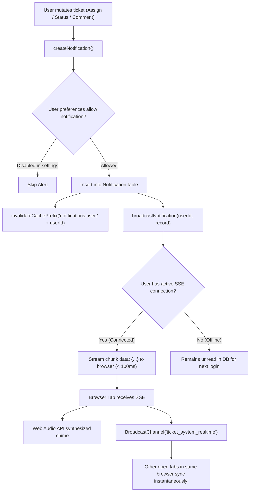

# Security, RBAC Matrix & Real-Time Notification Pipeline

## 1. Authentication & Session Architecture

Authentication is implemented via stateful, revocable sessions in [`src/lib/auth/session.ts`](file:///c:/Users/MIS/Documents/GitHub/CLOUD-LNK-TICKET-SYSTEM/src/lib/auth/session.ts).

### 1.1. Dual Token Extraction
When an incoming HTTP request hits any protected API route:
1. First inspects the HTTP-only secure cookie `lnk_session_token`.
2. Fallback: Inspects the `Authorization: Bearer <token>` header (supporting external webhook integration and mobile clients).
3. If valid, validates the token against the `Session` table in PostgreSQL.

### 1.2. Password Hashing & Instant Revocation
- Passwords are encrypted with Bcrypt (cost factor 10).
- When a user changes their password (`POST /api/user/change-password` or `/api/auth/change-password`):
  1. The password hash is updated.
  2. All other active sessions for that user (`prisma.session.deleteMany({ where: { userId, token: { not: currentToken } } })`) are deleted immediately.
  3. All cached clearances (`invalidateCachePrefix("user:spaces:" + userId)`) are purged.

---

## 2. The 3-Tier Enterprise RBAC Matrix

Defined in [`src/lib/security/rbac.ts`](file:///c:/Users/MIS/Documents/GitHub/CLOUD-LNK-TICKET-SYSTEM/src/lib/security/rbac.ts) and [`src/lib/security/permissions.ts`](file:///c:/Users/MIS/Documents/GitHub/CLOUD-LNK-TICKET-SYSTEM/src/lib/security/permissions.ts):

| Operational Capability | `SUPERADMIN` | `ADMIN` (Department Staff/Head) | `EMPLOYEE` (Standard Requester) |
| :--- | :---: | :---: | :---: |
| **Universal Ticket Intake** | Full Access | Full Access | **Full Access** *(Can file tickets in ANY department)* |
| **Sidebar Space Visibility** | Sees all spaces | Sees assigned member spaces | Sees assigned member spaces |
| **Ticket Modification Clearance** | Global | In assigned spaces + Assigned/Created | Only tickets they authored or are assigned |
| **Private Queue Access (`isPrivate`)** | Bypasses | Member of space only | Member of space only *(Hidden by default)* |
| **Internal Staff Notes (`isInternal`)** | Full Access | In assigned spaces only | **FORBIDDEN** *(Stripped from API responses)* |
| **Ticket Transfer / Handoff** | Any Space | From assigned spaces | **FORBIDDEN** |
| **User & Role Administration** | Full Access | View Only | Forbidden |
| **System Health & DB Backups** | Full Access | Forbidden | Forbidden |

### 2.1. Defense-in-Depth Layer 2 Assertion (`query-guard.ts`)
In [`src/lib/security/query-guard.ts`](file:///c:/Users/MIS/Documents/GitHub/CLOUD-LNK-TICKET-SYSTEM/src/lib/security/query-guard.ts), every read, update, or delete request calls `assertTaskAccess(taskId, user)`:
- Checks if the user is `SUPERADMIN`.
- Checks if the user is the Author (`createdById === user.id`).
- Checks if the user is the Assignee (`assigneeId === user.id`).
- Checks if the user is an explicit Contributor (`contributors.some(c => c.id === user.id)`).
- Checks if the user holds active membership in the ticket's current space or originating space.
- If all checks fail, **throws `ForbiddenError(403)`** and records an unauthorized security entry in the `AuditLog` table.

---

## 3. Real-Time Notification & SSE Event Pipeline

Implemented in [`src/lib/sse-broker.ts`](file:///c:/Users/MIS/Documents/GitHub/CLOUD-LNK-TICKET-SYSTEM/src/lib/sse-broker.ts) and [`src/lib/notifications.ts`](file:///c:/Users/MIS/Documents/GitHub/CLOUD-LNK-TICKET-SYSTEM/src/lib/notifications.ts).

### High-Level SSE & Broadcast Architecture

### 3.1. Server-Sent Events (SSE) Hub (`/api/notifications/stream`)
- **Persistent HTTP Streaming Connection:** Keeps a low-overhead HTTP connection open using `ReadableStream`.
- **Client Mapping:** `registerClient(userId, controller)` maps active users in a memory singleton `userClients: Map<string, Set<ClientController>>`.
- **Multi-Tab Fan-Out:** If a user has 3 tabs open, `userClients.get(userId)` holds 3 controllers; an incoming notification streams to all 3 tabs simultaneously.

### 3.2. Cross-Tab Synchronization via `BroadcastChannel`
In [`src/context/workspace-context.tsx`](file:///c:/Users/MIS/Documents/GitHub/CLOUD-LNK-TICKET-SYSTEM/src/context/workspace-context.tsx):
- Initialized with `new BroadcastChannel('ticket_system_realtime')`.
- When an SSE event arrives or a user marks a notification as read in Tab A:
  - Tab A broadcasts `{ type: 'NOTIFICATION_READ', id }` across the channel.
  - Tab B and Tab C immediately update their badge counts and notification drawer in `0ms` without making extra network requests to the server.

### 3.3. Synthesized Web Audio Chimes
To prevent asset load failures or missing sound files in corporate air-gapped environments, audio chimes are synthesized dynamically in JavaScript using the **HTML5 Web Audio API** (`AudioContext.createOscillator()`), generating crisp, modern alert tones without external `.mp3` dependencies.
