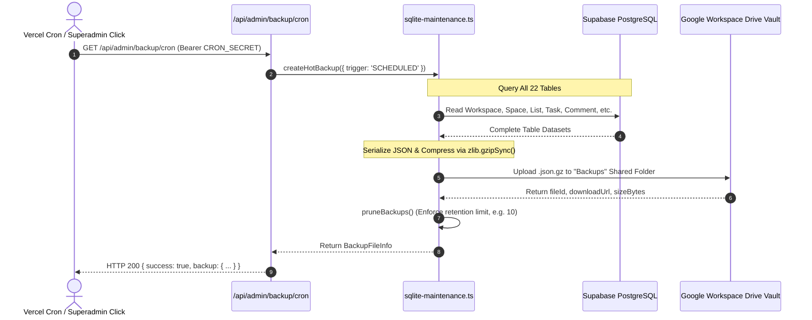

# Superadmin Operations & Disaster Recovery Architecture

## 1. System Health Telemetry Dashboard

Implemented in [`src/app/api/admin/system-health/route.ts`](file:///c:/Users/MIS/Documents/GitHub/CLOUD-LNK-TICKET-SYSTEM/src/app/api/admin/system-health/route.ts) and visual components in [`src/components/admin/SystemHealthBackupCard.tsx`](file:///c:/Users/MIS/Documents/GitHub/CLOUD-LNK-TICKET-SYSTEM/src/components/admin/SystemHealthBackupCard.tsx).

The telemetry engine gathers real-time diagnostics across both the database and cloud storage layers:

| Diagnostic Metric | Source & Measurement Strategy | Normal Benchmark | Warning Threshold |
| :--- | :--- | :--- | :--- |
| **PostgreSQL Ping Latency** | `SELECT 1;` query timed with `performance.now()` | `10ms – 35ms` | `> 100ms` (Network congestion or pool starvation) |
| **Database Size** | `SELECT pg_database_size(current_database())::bigint;` | `10MB – 100MB` | `> 500MB` (Investigate unvacuumed dead tuples) |
| **Google Drive Vault Quota** | Apps Script `PING` querying Drive storage usage | `< 50% Used` | `> 85% Used` (Corporate drive reaching cap) |
| **Server RSS Memory** | `process.memoryUsage().rss` in Node.js runtime | `80MB – 180MB` | `> 512MB` (Memory leak inspection) |
| **Active Table Records** | Live count of `Task`, `Comment`, `User`, `Attachment` | Scalable | N/A |

---

## 2. The Hot Backup Pipeline (`createHotBackup`)

Implemented in [`src/lib/sqlite-maintenance.ts`](file:///c:/Users/MIS/Documents/GitHub/CLOUD-LNK-TICKET-SYSTEM/src/lib/sqlite-maintenance.ts).



### 2.1. Cloud Mode Execution (PostgreSQL + Google Drive)
1. **Full Relational Export:** Queries all 22 database tables in dependency order.
2. **Gzip Compression:** Serializes the records into JSON and compresses the payload in-memory using Node.js `zlib.gzipSync()`, achieving **85%–90% compression ratios** (e.g. a 20MB raw JSON dataset shrinks to ~2.2MB).
3. **Google Drive Upload:** Sends the `.json.gz` stream to the Google Drive `Backups` shared folder via [`uploadToGoogleDrive()`](file:///c:/Users/MIS/Documents/GitHub/CLOUD-LNK-TICKET-SYSTEM/src/lib/google-drive-bridge.ts).
4. **Local Disk Mirroring:** Simultaneously caches a copy in `./backups/` if running in an environment with persistent local disk storage.

### 2.2. SQLite Mode Execution (On-Premise Server)
1. Executes `PRAGMA wal_checkpoint(TRUNCATE);` to flush all uncommitted WAL frames into the primary database file.
2. Executes an atomic `VACUUM INTO '<backup-path>';` to generate a non-blocking snapshot without stopping user transactions.

---

## 3. Automated Multi-Schedule Engine

The platform combines **Vercel Cron** with dynamic **Database-Driven Multi-Schedules**:

### 3.1. Vercel Hobby Midnight Cron ([`vercel.json`](file:///c:/Users/MIS/Documents/GitHub/CLOUD-LNK-TICKET-SYSTEM/vercel.json))
```json
{
  "crons": [
    {
      "path": "/api/admin/backup/cron",
      "schedule": "0 16 * * *"
    }
  ],
  "functions": {
    "src/app/api/admin/**": {
      "maxDuration": 60
    }
  }
}
```
- **Schedule:** `0 16 * * *` is 16:00 UTC, which equals **12:00 AM (Midnight) Philippine Standard Time (PHT)**.
- **Authentication:** Vercel automatically includes `Authorization: Bearer ${process.env.CRON_SECRET}`.

### 3.2. Dynamic Multi-Schedule Slots in `SystemSetting`
Superadmins can configure multiple custom backup schedules (e.g., Midday 12:00 PM, Weekly Sunday 2:00 AM) directly from the UI:
- Stored in the `SystemSetting` table under key `backup_schedules_json`.
- Each schedule defines:
  ```typescript
  export interface BackupScheduleItem {
    id: string;
    label: string;
    enabled: boolean;
    frequency: 'DAILY' | 'WEEKLY' | 'HOURLY' | 'EVERY_6_HOURS' | 'EVERY_12_HOURS';
    timeOfDay: string; // "HH:mm"
    dayOfWeek?: number;
    lastRunAt: string | null;
    lastRunDurationMs?: number | null;
    lastRunStatus: 'SUCCESS' | 'ERROR' | null;
    nextRunAt: string | null;
  }
  ```

### 3.3. Retention & Automatic Pruning (`pruneBackups`)
- Retention policy is configurable (default: **10 latest snapshots**).
- When an automated backup completes, `pruneBackups()` evaluates the existing snapshots in Google Drive and local storage, permanently removing older snapshots to prevent storage bloat.

---

## 4. Disaster Recovery & One-Click System Restoration

If data corruption, accidental deletion, or server failure occurs:

### 4.1. Snapshot Download
- Superadmins can download any historical backup snapshot directly from the System Health UI:
  `GET /api/admin/system-health?download=lk-ticketing-auto-2026-10-28.json.gz&fileId=1A2B3C...`
- The server streams the `.json.gz` file directly from Google Drive.

### 4.2. One-Click Full Database Restoration ([`/api/admin/data/import`](file:///c:/Users/MIS/Documents/GitHub/CLOUD-LNK-TICKET-SYSTEM/src/app/api/admin/data/import/route.ts))
1. Superadmin uploads the `.json.gz` file via the Disaster Recovery card in `/admin`.
2. The server decompresses the file, verifies schema integrity, and restores all tables in strict topological order:
   `Workspace` -> `User` -> `Space` -> `SpaceMember` -> `List` -> `TaskStatus` -> `Task` -> `TaskHistory` -> `TaskComment` -> `TaskAttachment` -> `Notification`.
3. Clears all server RAM caches via `clearServerCache()`.
4. Emits real-time event `WORKSPACE_RESTORED` across all client browser tabs.
